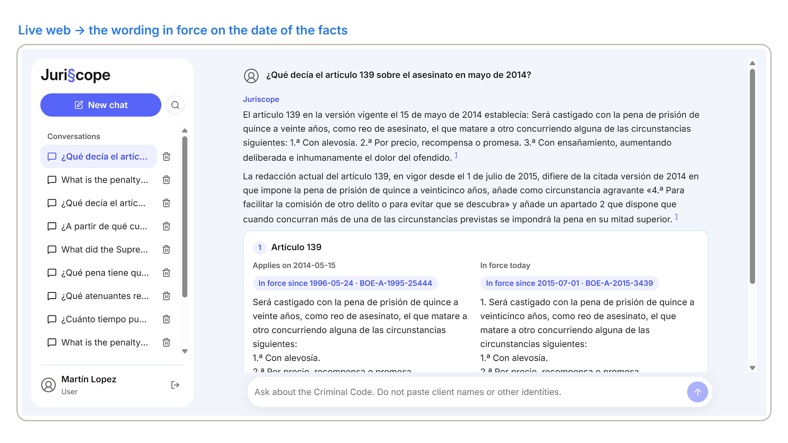
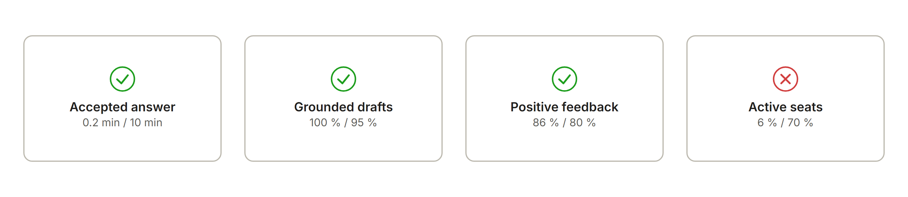
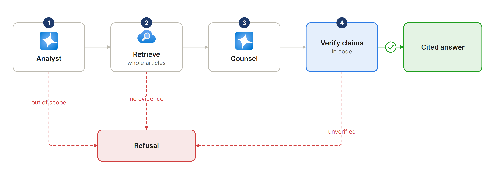
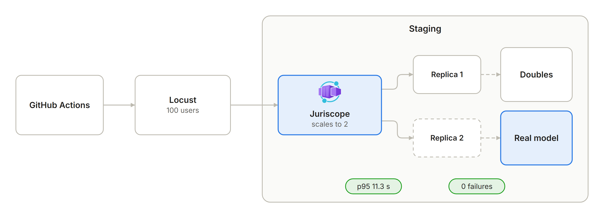
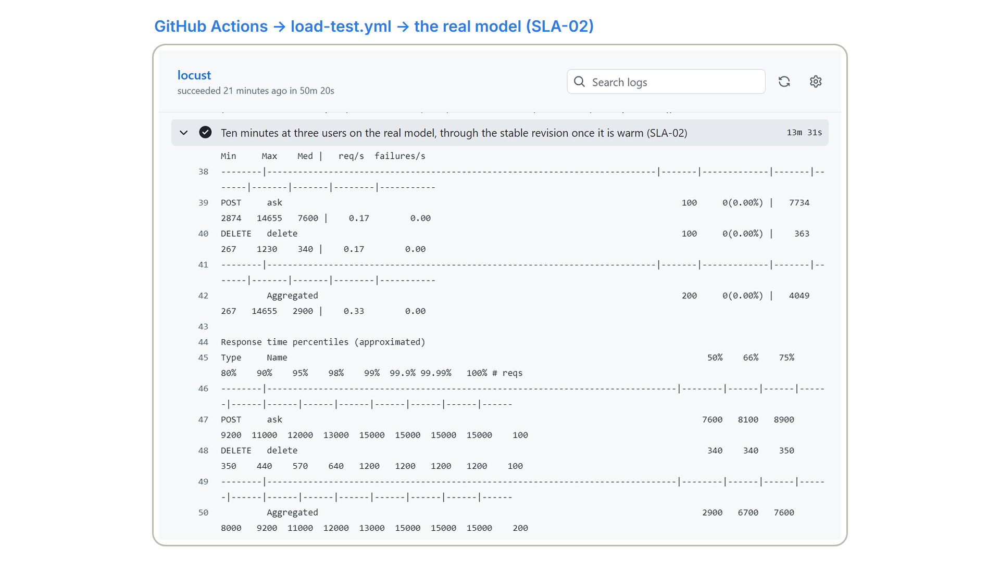

# <picture><source media="(prefers-color-scheme: dark)" srcset="docs/images/brand/juriscope-logo-white.png"></picture>

Built by **Rodrigo Martín Gómez del Moral Herranz**

&nbsp;&nbsp;&nbsp;&nbsp;

Juriscope is an AI research assistant on Azure for criminal-law firms: it answers questions on the Spanish Criminal Code with every
claim cited, the full article and the wording in force on the date of the facts, and it refuses when the Code does not support an
answer. A firm's lawyers spend about 80 minutes on each research question, and the costly mistake is citing a wording that was not
in force then. Juriscope answers in about 8 seconds (median 7.6 s; 95 % within 11.3 s on 100 answers in the load test of release
v1.0.2, 2026-11-09), and the lawyer's estimated time per question falls from 50 to 115 minutes to 25 to 50.

**Live demo:** <https://rodrigo-gomezdelmoral.github.io/product-legal-juriscope/> - five runs recorded from the deployed system on 2026-11-03, replayed with their real timings and no backend, and an evidence panel.

> **All client data is synthetic.** The Criminal Code is the real consolidated text from the BOE; the firm, its volumes and
> times are the product brief's ([`docs/PRODUCT.md`](docs/PRODUCT.md)), and production's figures come from the author's test
> traffic (the walk-through, rehearsals and the demo recording), not from lawyers' work.

Production, 2026-11-09: asked what article 139 said in May 2014, Juriscope cites it and shows the wording that applied then
beside the one in force today.

## The problem

The client is a mid-size criminal-law firm in Madrid (fictional): 14 lawyers, 4 paralegals and a knowledge lead. It handles about
350 research questions a month, at 50 to 115 minutes each, about 470 lawyer-hours a month (the firm's estimates, 2026-10-30).

Time is not the expensive part. The Criminal Code has been amended many times since 1995, and the wording that applies to a case is
the one in force when the facts happened, not the one on the screen today. Today that check depends on each lawyer's diligence.

What the firm buys: every claim cited to an article with a link to the official text, the whole article verbatim, the version that
applies with its amending law, an explicit refusal when the Code is silent, and a safe way to change prompts and models.

Today a lawyer delimits the question (5 to 10 min), lists the possible offences and articles (5 to 15), finds them in the BOE
(Spain's Official State Gazette) or a database (5 to 10), reads the whole articles (5 to 15), checks every amendment for the wording
in force on the date of the facts (5 to 15), reads related articles (10 to 20), drafts a note (10 to 20) and reviews it (5 to 10).

## What it does

- **Cites every claim.** Each statement carries a numbered citation to an article that was retrieved for the question; the application drops
  any claim whose citation was not retrieved, so the model cannot cite an article it did not read.
- **Shows the whole article, in the right version.** The article text comes from the official version store, never from the model.
  When the question gives a date of the facts, the card shows the wording that applied beside today's.
- **Refuses on purpose.** Case law, other laws, non-legal questions and questions with no supporting article get a refusal card
  with the reason and a suggestion.
- **Keeps the conversation.** Follow-ups resolve through history; conversations are listed, resumed and deleted, and expire after
  90 days.
- **Changes safely.** Every change to prompts, agents or models passes an evaluation gate on the pull request.

With Juriscope, the lawyer delimits the question and asks it. Juriscope does the machine part of steps 2 to 6 in seconds: the
*Analyst* agent extracts the concepts, the Spanish queries and the date of the facts; hybrid and semantic search finds the
articles; the version store rebuilds them whole in the right version; the *Counsel* agent drafts cited claims; application
code verifies them. The lawyer reads the answer and the articles (5 to 10 min), drafts and reviews. The total falls from 50 to 115
minutes to 25 to 50, saving about 146 to 379 lawyer-hours a month (estimates; K1 measures the real value).

## Requirements

Eleven requirements and two SLAs, defined with *Given/When/Then* criteria in [`docs/PRODUCT.md`](docs/PRODUCT.md). Every *Must* has
a test, live evidence in staging, a take of the demo video, recorded in production on 2026-11-09, and a recorded run or evidence in
the published demo: S1 to S5 are the five runs it replays, and *evidence panel* is its evidence page. The take numbers on the board
are those of that video.

| REQ | Must | Staging | Production | Evidence |
|---|---|---|---|---|
| REQ-01 | Every claim cites its article, linked to boe.es | done | met | `test_claims_cite_retrieved_articles`; citation precision 1.000 on 57 cases (2026-11-03); take 14; S1 |
| REQ-02 | The whole article, not a fragment | done | met | `test_full_article`, `test_answer_carries_full_articles`; *Show full article* in the browser (2026-11-01); take 14; S1 |
| REQ-03 | The version that applies | done | met | `test_version_at`, `test_facts_date_selects_version`; version accuracy 1.000 on 15 cases (2026-11-03); 2014 and 2015 wordings side by side (the image at the top); take 15; S2 |
| REQ-04 | An explicit refusal | done | met | `test_out_of_scope_refused_without_retrieval`, `test_no_evidence_refusal`; correct refusal 1.000 on 20 cases, false refusal 0.040 on 75 (2026-11-03); take 16; S3 |
| REQ-05 | An evaluation gate on every change | done | met | `eval/run.py` exit code; `eval.yml` passed on PRs #19 and #24, and the full suite on `main` (run 41719593012, 2026-11-03), the same `app/` as v1.0.2; evidence panel |
| REQ-06 | Saved conversations: list, resume, delete | done | met | `test_resume`, `test_delete`; follow-up, reload, resume and delete in the browser (2026-11-01); takes 17 and 18; S4 |
| REQ-07 | Only signed-in members with the role, each seeing their own | done | met | `test_401`, `test_403`, `test_404_other_user`; 401 without a session and with a forged header, 404 for another id (2026-11-03); take 6; evidence panel |

The *Should* and *Could* requirements: "See also" references (REQ-08, S1), 👍/👎 feeding K3 (REQ-09, `FeedbackGiven` seen in KQL),
a 90-day TTL on both Cosmos DB containers (REQ-10, read on the deployed account), and answers in the language of the question (REQ-11,
answer language 0.975 on 81 cases on 2026-11-03, S5).
The evaluation figures dated 2026-11-03 are the full suite on `main`, the same `app/` as v1.0.1 and v1.0.2 ([`docs/evaluation.md`](docs/evaluation.md)).

The two SLAs committed to the firm, against what was measured in staging and in production:

| SLA | Committed | Staging, 2026-11-01 to 2026-11-09 | Production, 30 days to 2026-11-10 (test traffic) |
|---|---|---|---|
| SLA-01 Availability | ≥ 99.5 % a month | 100 %: no stage of the load test of 2026-11-09 had a failure | 100 % of 262 `/api` requests since v1.0.0 (2026-11-03), none with a 5xx; a full calendar month is not yet measurable; the workbook does not yet count a question that fails after its stream has started (known limitation, [`docs/OPERATIONS.md`](docs/OPERATIONS.md#alerts)) |
| SLA-02 Latency | 95 % of answers under 15 s, progress within 0.1 s | exact p95 11.3 s (11,337 ms) on 100 real-model answers, 0 failed, on the container image now in production (`load-test.yml` run 42687323423, 2026-11-09); progress in 10 to 27 ms (browser, 2026-11-01) | 49 of 51 asks under 15 s |

## KPIs

Computed from custom events in Application Insights, without question or answer text, and shown in the KPI workbook declared in
Bicep; read in production on 2026-11-10, over 30 days of test traffic.

| KPI | Target | Measured in production | Cases |
|---|---|---|---|
| K1 Time to accepted answer: median minutes from `QuestionAsked` to the first copy or 👍 | ≤ 10 min, from 30 to 75 today for steps 2 to 6 | 0.2 min | 12 accepted turns |
| K2 Grounded first draft: answered turns with no claim dropped ÷ answered turns | ≥ 95 % | 100 % | 40 of 40 answered turns |
| K3 Helpful answers: 👍 ÷ (👍 + 👎) | ≥ 80 % | 85.7 % | 12 of 14 votes |
| K4 Weekly active seats: distinct users asking in an ISO week ÷ 18 seats | ≥ 70 % | **5.6 %**, missed | 1 of 18 seats, the author |

Production figures were read on 2026-11-10 with the workbook's queries over 30 days, which hold everything since v1.0.0
(2026-11-03): 51 questions, all test traffic from one account, the author's test user (the walk-through of 2026-11-03,
rehearsals on 2026-11-04 and the demo recording of 2026-11-09). They prove that the events arrive and say nothing about the
firm's use: K4 is red because one person, not 18 seats, has used production so far.

## Repo card

| | |
|---|---|
| **Type** | AI product for a criminal-law firm's lawyers and paralegals: research support on the Spanish Criminal Code |
| **Client and users** | a fictional Madrid firm, 14 lawyers and 4 paralegals with the `Juriscope.User` role, and a knowledge lead who reads the workbook |
| **Azure services** | per environment: Container Apps, Cosmos DB for NoSQL serverless, Storage, Key Vault, Application Insights, alerts and a budget. Shared by staging and production: one Container Apps environment. Shared platform, deployed separately: Foundry models, AI Search, Container Registry and Log Analytics |
| **AI** | `gpt-5-mini` (2025-08-07) for *Analyst* and *Counsel*, `text-embedding-3-small`; Microsoft Agent Framework, a graph workflow exposed as an agent, self-hosted; hybrid and semantic search; verification in code |
| **Stack** | Python 3.12, FastAPI, server-sent events; a React 19 and TypeScript chat interface; Bicep; Locust |
| **Environments and delivery** | local with the Cosmos DB emulator; staging and production in Azure. One container image per merge, deployed to staging by digest; a GitHub Release promotes the same digest to production with a 10 % canary and the author's approval; GitHub Actions with OIDC, no stored Azure secrets |
| **Security** | Entra ID sign-in through Easy Auth with an app role, managed identities, local auth off on every data service, the only secret in Key Vault, no question text in telemetry, CodeQL, Dependabot and secret scanning |
| **SLA** | 99.5 % availability: 100 % of 262 `/api` requests in production (30 days to 2026-11-10, test traffic); 95 % of answers under 15 s: exact p95 11.3 s on the released container image (load test, 2026-11-09), and 49 of 51 production asks under 15 s |
| **Demo** | <https://rodrigo-gomezdelmoral.github.io/product-legal-juriscope/> |

## Architecture

One container app serves the API and the web behind Entra ID sign-in ([ADR-006](docs/adr/006-sign-in-with-easy-auth.md)), and
calls every service with its managed identity. The app runs in France Central, in the one Container Apps environment the product
has ([ADR-014](docs/adr/014-one-container-apps-environment.md)); data stays in Sweden Central and the index of the public Code in
Spain Central ([ADR-009](docs/adr/009-inference-and-data-residency.md)). The details are in [`docs/architecture.md`](docs/architecture.md).

## How it works

### A graph workflow, verified in code

`POST /api/conversations/{id}/messages` runs a graph workflow ([ADR-001](docs/adr/001-graph-workflow.md)): `analyze` can end in a
refusal before any search; `retrieve` runs hybrid and semantic search and rebuilds whole articles in the version for the date of the
facts; `draft` asks *Counsel* for structured claims; `verify` drops claims that cite articles not retrieved and refuses when none is
left ([ADR-005](docs/adr/005-structured-output-and-verification.md)). The client sees one progress line per step, then one answer or
one refusal ([ADR-004](docs/adr/004-stream-progress-not-tokens.md)). History lives in Cosmos DB through the framework's
`CosmosHistoryProvider` ([ADR-002](docs/adr/002-history-in-cosmos-db.md)).

### Whole articles, in the version that applies

Search finds the chunks of the Code; the article text never comes from them. The application maps each chunk to its articles and
rebuilds them, whole, from the BOE version store shipped in the container image, picking the wording in force on the date of the
facts that the *Analyst* agent extracted, and shows today's wording beside it ([ADR-003](docs/adr/003-layout-index-and-version-store.md)).

## In action

Recorded in production on 2026-11-09:

- **An answer with the version that applies** (the image at the top): asked what article 139 said in May 2014, Juriscope cites it
  and shows the wording that applied then beside the one in force today.
- **A refusal on purpose** (below): asked what the Supreme Court has said on putative self-defence, Juriscope answers from the text
  of the Code, not from case law, so it refuses and says where to look.

The published demo replays the same refused question, recorded on 2026-11-03 (S3), and four other runs.

## Environments and releases

| | Staging | Production |
|---|---|---|
| App | `ca-juriscope-stg`, 0 to 2 replicas | `ca-juriscope-prod`, 1 warm replica ([ADR-008](docs/adr/008-production-warm-replica.md)), up to 4 |
| Data | `cosmos-juriscope-stg-swc`, index `jur-articles-stg` | `cosmos-juriscope-prod-swc`, index `jur-articles-prod` |
| Alerts | declared, disabled | 5xx, availability and p95; availability counts 5xx only, not a failure inside a started stream (known limitation) |
| Changes by | every merge to `main` (`deploy.yml`) | a GitHub Release (`release.yml`), with approval |

- **Image:** a merge builds one container image, deploys it to staging by digest and uploads the digest.
- **Release:** `release.yml` finds that digest for the tagged commit, requires the `load-test` status on it unless only the web,
  docs or workflows changed ([ADR-015](docs/adr/015-release-without-load-test-for-web-and-docs.md)), deploys it as a new
  revision, smoke-tests it on the `canary` label, sends it 10 % of traffic for twelve minutes, reads its requests and 5xx from the
  Container Apps `Requests` metric of that revision, and moves to 100 % or rolls back. The p95 of one revision is not measured yet
  (known limitation).
- **Rollback:** in a production rehearsal (2026-11-03), rolling back by revision took 47 s and rolling forward again 21 s; a planned
  redeploy of an earlier release took 17 min 16 s with approval and canary. Commands and times are in
  [`docs/OPERATIONS.md`](docs/OPERATIONS.md).

### Load tests

Up to 100 users run against a model double, a stand-in for the model; the SLA-02 stage then runs 3 users on the real model
(p95 11.3 s). No stage had a failure.

Run 42687323423 of `load-test.yml`, 2026-11-09 19:51 to 20:41 UTC, on the v1.0.2 commit `dff9470` and the digest now in
production: Locust 2.47.0 against a staging revision with a model double, then the real model on the warm stable revision. Rates
and percentiles are for the ask route. Rates are Locust's; percentiles are Locust's approximations, except the real-model p95:
Locust's column shows 12 s, and the exact p95 over the 100 asks is 11.3 s
([ADR-017](docs/adr/017-exact-p95-and-a-longer-real-stage.md)).

| Scenario | Load | p50 | p95 | p99 | Requests/s | Errors | Replicas |
|---|---|---|---|---|---|---|---|
| normal, model double | 5 users | 1.0 s | 5.5 s | 5.5 s | 0.46 | 0 of 82 | ≤ 2 |
| peak, model double | 20 users | 1.3 s | 7.6 s | 7.9 s | 1.67 | 0 of 200 | ≤ 2 |
| soak, model double | 5 users | 0.97 s | 1.4 s | 2.0 s | 0.45 | 0 of 270 | ≤ 2 |
| stress, model double | 5 to 100 users | 2.7 s | 13 s | 23 s | 3.34 | 0 of 3,998 | ≤ 2 |
| real model (SLA-02) | 3 users | 7.6 s | 11.3 s | 15 s | 0.17 | 0 of 100 | ≤ 2 |

At most 2 replicas, 0.51 vCPU and 0.53 GiB over the run. The earlier runs, the v1.0.0 one among them (2026-11-03, run
41661582947: p95 12.8 s on 96 asks), and the failed ones are in [`docs/OPERATIONS.md`](docs/OPERATIONS.md#load-tests).

### SLOs and DORA

- **SLOs** (production from v1.0.0): availability ≥ 99.7 %, p95 < 13 s, 5xx < 1 %, ≤ 0.05 € per question all-in; RTO 4 h (drill:
  12 min 17 s) and RPO 15 min. Measured in production on 2026-11-10 over 30 days, all of it test traffic: availability 100 % of 262
  `/api` requests and no 5xx, both met; p95 of the ask route 14.1 s (14,145 ms) on 51 asks, above the 13 s SLO, while the 15 s
  SLA is met (49 of 51 asks under 15 s); cost 0.005 € a turn in tokens and search as the app measures it (median of 48), about
  0.037 € all-in at 350 questions a month (see [Cost](#cost)), within the 0.05 € SLO. Fifty-one asks are few for a p95; the
  SLA-02 gate stays the load test.
- **DORA**, from the GitHub Actions runs ([`docs/OPERATIONS.md`](docs/OPERATIONS.md#dora)):

| Metric | Staging, 2026-11-01 to 2026-11-09 | Production, 2026-11-03 to 2026-11-09 |
|---|---|---|
| Deployment frequency | 16 `deploy.yml` runs with a result, 14 successful | 3 releases: v1.0.0 and v1.0.1 on 2026-11-03, v1.0.2 on 2026-11-09 |
| Lead time for changes | 5 to 8 minutes from merge to staging | v1.0.0: 8 minutes from tag to production, 2 h 46 min from merge, the load test included; v1.0.1: 18 minutes from tag, 33 minutes from merge; v1.0.2: 25 minutes from tag, approval and canary included, merged on 2026-11-04 and held for the demo recording and its load test |
| Change failure rate | 2 of 16 | 0 of 3 |
| Time to restore | 34 and 17 minutes | no incident; a rehearsed time to restore of 47 s by revision |

## Cost

EUR a month ([`docs/cost.md`](docs/cost.md)):

| | Staging | Production |
|---|---|---|
| At rest | about 0.1 | about 11.2 (the warm replica and the availability and p95 log alerts; the 5xx metric alert is not priced) |
| In use | about 1 (≤ 2.3) | about 13 to 15 at 350 questions |
| Budget | 10 | 25 |

A question costs a median of 0.0052 € in tokens and search (measured in staging on 5 answers, 2026-11-01) and 0.005 € in
production as the app measures it (48 turns, 30 days to 2026-11-10), about 0.037 € all-in in production at 350 questions a month,
against a 0.05 € SLO. The shared platform (search 64.88 € and registry 4.46 € a month) is not counted per product. Details in [`docs/cost.md`](docs/cost.md).

## Well-Architected design

| Pillar | Applied | Trade-off accepted |
|---|---|---|
| Reliability | clear 503s with `Retry-After` for a throttled model or a dependency down, SDK retries and timeouts, probes, a deadline on *Analyst*, continuous backup with a measured restore | one search replica, no zones, one region (ADR-007, ADR-011) |
| Security | managed identities, least privilege, local auth off, Easy Auth with an app role, one secret in Key Vault, segmentation by group, identity and data | no private endpoints, no Defender plans (ADR-011) |
| Cost Optimization | cost per question measured, tags, replica caps, TPM caps, `max_tokens`, budgets, staging at zero, log caps | production keeps one warm replica (ADR-008) |
| Operational Excellence | Bicep with `what-if`, build once and promote the digest, canary with rollback, incident procedure, DORA | no per-revision p95 during the canary yet; staging alerts declared but disabled |
| Performance Efficiency | p95 targets, Locust in staging before promotion, managed platform features first (Easy Auth, Container Apps scaling and metrics) | cross-region calls from France Central (ADR-014) |

## Deploy

Deployment runs only through GitHub Actions: a merge to `main` deploys staging (`deploy.yml`), and
`gh release create vX.Y.Z --title vX.Y.Z --notes-file <the CHANGELOG section>` deploys production after the author approves
(`release.yml`). Prerequisites: an Azure subscription with the shared platform (Foundry project with `gpt-5-mini` and
`text-embedding-3-small`, AI Search, Container Registry, Log Analytics), and the two resource groups.

### Bootstrap

The author's scripts, kept outside the repository, create the GitHub settings (ruleset, environments, security, Pages), the resource
groups, the runtime identities and the CI identities, then the sign-in app per environment.

### Federated credentials

`gh-product-legal-juriscope-staging` trusts the `staging` environment and pull requests; `gh-product-legal-juriscope-production`
trusts the `production` environment. Both use the repository's immutable OIDC subject.

### GitHub secrets and variables

- Repository secrets, so that public run logs never print them: `AZURE_TENANT_ID`, `AZURE_SUBSCRIPTION_ID`, `EVAL_CLIENT_ID` (the
  evaluation identity of pull requests), `ALERT_EMAIL_ADDRESS`, `REGISTRY_LOGIN_SERVER`, `FOUNDRY_PROJECT_ENDPOINT`,
  `FOUNDRY_ACCOUNT_ENDPOINT` and `SEARCH_ENDPOINT`.
- Per environment (`staging`, `production`): the secrets `AZURE_CLIENT_ID`, `AUTH_CLIENT_ID` and `AUTH_CLIENT_SECRET`. The sign-in
  apps' client secrets expire in November 2027; [`docs/OPERATIONS.md`](docs/OPERATIONS.md) gives the dates and the rotation steps.
- Variables: `CHAT_MODEL`, `EMBEDDING_MODEL`, `EVAL_SEARCH_INDEX` and `DEPLOY_ENABLED`.

### Identities

The CI principals hold Contributor and a conditioned RBAC Administrator on their own resource group, plus the shared-platform roles
their workflows need. The runtime identities hold AcrPull, Foundry User and Search Index Data Reader on the shared platform; the Bicep
grants their Cosmos DB, Key Vault and Application Insights roles. [`docs/THREAT_MODEL.md`](docs/THREAT_MODEL.md) covers the trust
boundaries and the RBAC Administrator condition.

## Documentation

- [`docs/PRODUCT.md`](docs/PRODUCT.md): client, process, requirements, KPIs and SLOs
- [`docs/OPERATIONS.md`](docs/OPERATIONS.md): environments, promotion, rollback, alerts, restore, incidents, load tests and DORA
- [`docs/THREAT_MODEL.md`](docs/THREAT_MODEL.md): assets, trust boundaries, STRIDE threats with their mitigations and residual risks
- [`docs/RESPONSIBLE_AI.md`](docs/RESPONSIBLE_AI.md): the responsible AI impact assessment
- [`docs/evaluation.md`](docs/evaluation.md): the datasets, the evaluators, the gate in CI and the measurements, the full suite on
  `main` included
- [`docs/architecture.md`](docs/architecture.md): regions, the request path and the deployment path
- [`docs/cost.md`](docs/cost.md): prices, the cost per environment and per question, the measured cost and the shared base
- [`docs/adr/`](docs/adr/): the 17 architecture decisions
- [`CHANGELOG.md`](CHANGELOG.md) and the latest release,
  [`v1.0.2`](https://github.com/Rodrigo-GomezdelMoral/product-legal-juriscope/releases/tag/v1.0.2) (2026-11-09); all the
  [releases](https://github.com/Rodrigo-GomezdelMoral/product-legal-juriscope/releases)

## Author

**Rodrigo Martín Gómez del Moral Herranz**

&nbsp;&nbsp;&nbsp;&nbsp;
