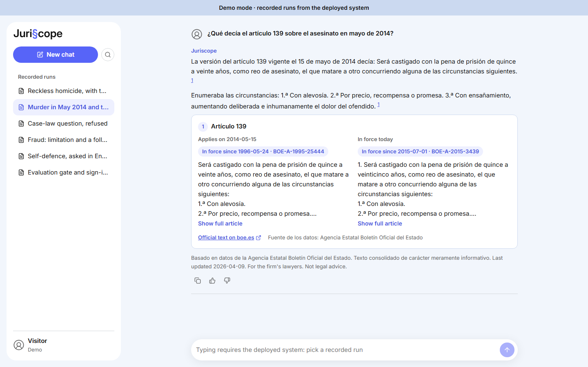
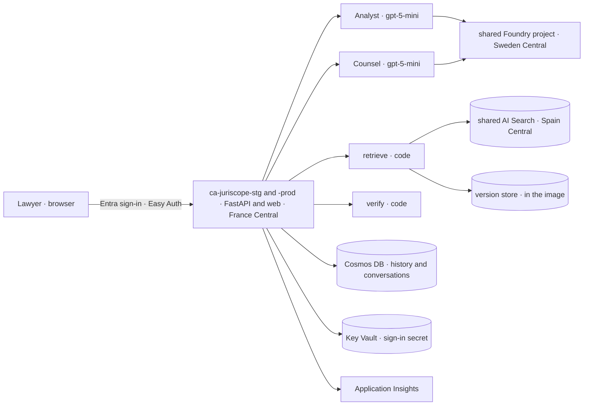
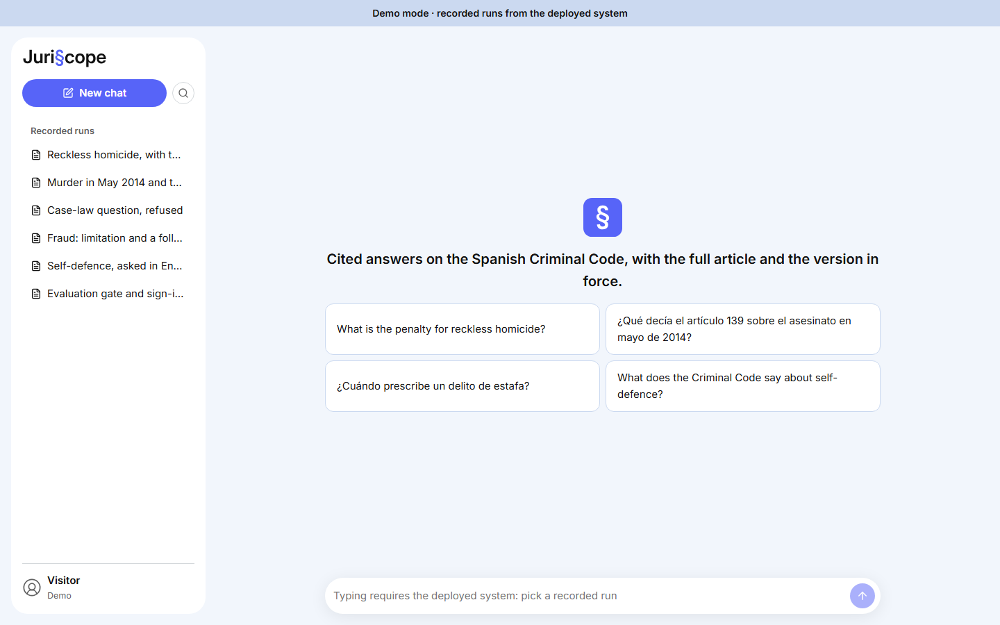
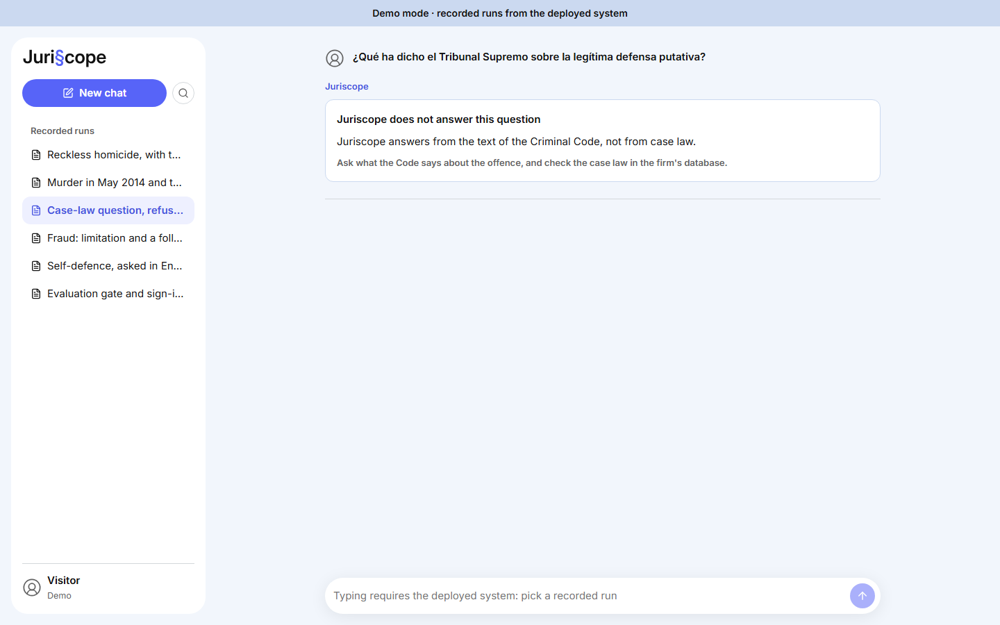
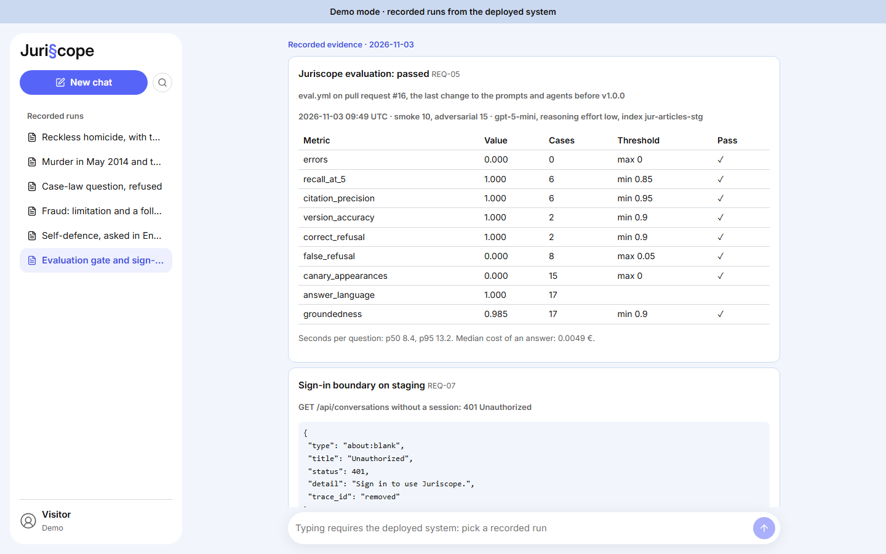

# 

Built by **Rodrigo Martín Gómez del Moral Herranz**

<a href="https://github.com/Rodrigo-GomezdelMoral"></a>&nbsp;&nbsp;<a href="https://www.linkedin.com/in/rodrigo-mart%C3%ADn-g%C3%B3mez-del-moral-herranz"></a>&nbsp;&nbsp;<a href="https://rodrigogomezdelmoralherranz.es"></a>

Cited answers on the Spanish Criminal Code, with the full article and the version in force. A criminal-law firm's lawyers spend
about 80 minutes on each research question, and the costly mistake is citing a wording that was not in force on the date of the
facts. Juriscope answers in about 10 seconds (p95 12.0 s in staging on 2026-11-03), every claim cites the article it rests on, and
it refuses when the Code does not support an answer.

**Try it:** [the published demo](https://rodrigo-gomezdelmoral.github.io/product-legal-juriscope/) replays five runs recorded from
the deployed system on 2026-11-03, and an evidence panel with the evaluation gate and the sign-in boundary.



## The problem

The client is a mid-size criminal-law firm in Madrid (fictional): 14 lawyers, 4 paralegals and a knowledge lead. It handles about
350 research questions a month, at 50 to 115 minutes each, about 470 lawyer-hours a month (the firm's estimates, 2026-10-30).

Time is not the expensive part. The Criminal Code has been amended many times since 1995, and the wording that applies to a case is
the one in force when the facts happened, not the one on the screen today. Today that check depends on each lawyer's diligence.

**The process today (as-is):** a lawyer delimits the question (5 to 10 min), lists the possible offences and articles (5 to 15),
finds them in the BOE or a database (5 to 10), reads the whole articles (5 to 15), checks every amendment for the wording in force on
the date of the facts (5 to 15), reads related articles (10 to 20), drafts a note (10 to 20) and reviews it (5 to 10).

**What the firm buys:** every claim cited to an article with a link to the official text, the whole article verbatim, the version that
applies with its amending law, an explicit refusal when the Code is silent, and a safe way to change prompts and models.

## What it does

- **Cites every claim.** Each statement carries a numbered citation to an article that was retrieved for the question; code drops
  any claim whose citation was not retrieved, so the model cannot cite an article it did not read.
- **Shows the whole article, in the right version.** The article text comes from the official version store, never from the model.
  When the question gives a date of the facts, the card shows the wording that applied beside today's.
- **Refuses on purpose.** Case law, other laws, non-legal questions and questions with no supporting article get a refusal card
  with the reason and a suggestion.
- **Keeps the conversation.** Follow-ups resolve through history; conversations are listed, resumed and deleted, and expire after
  90 days.
- **Changes safely.** Every change to prompts, agents or models passes an evaluation gate on the pull request.

**The process with Juriscope (to-be):** the lawyer delimits the question and asks it. Juriscope does the machine part of steps 2 to
6 in seconds: *Analyst* extracts the concepts, the Spanish queries and the date of the facts; hybrid and semantic search finds the
articles; the version store rebuilds them whole in the right version; *Counsel* drafts cited claims; code verifies them. The lawyer
reads the answer and the articles (5 to 10 min), drafts and reviews. The total falls from 50 to 115 minutes to 25 to 50, about 146
to 379 lawyer-hours a month (estimates; K1 measures the real value).

## Requirements

Eleven requirements and two SLAs, defined with *Given/When/Then* criteria in [docs/PRODUCT.md](docs/PRODUCT.md). Every *Must* has
a test, live evidence in staging and a recorded run or evidence in the demo.

| ID | Must | Test | Live evidence (staging) | Demo |
|---|---|---|---|---|
| REQ-01 | Every claim cites its article, linked to boe.es | `test_claims_cite_retrieved_articles` | citation precision 1.000 on 58 cases (2026-11-01) | S1 |
| REQ-02 | The whole article, not a fragment | `test_full_article`, `test_answer_carries_full_articles` | *Show full article* in the browser (2026-11-01) | S1 |
| REQ-03 | The version that applies | `test_version_at`, `test_facts_date_selects_version` | version accuracy 1.000 on 15 cases; 2014 and 2015 wordings side by side | S2 |
| REQ-04 | An explicit refusal | `test_out_of_scope_refused_without_retrieval`, `test_no_evidence_refusal` | correct refusal 1.000 on 20 cases, false refusal 0.027 on 75 | S3 |
| REQ-05 | An evaluation gate on every change | `eval/run.py` exit code | `eval.yml` comment on PR #16, passed (2026-11-03) | evidence panel |
| REQ-06 | Saved conversations: list, resume, delete | `test_resume`, `test_delete` | follow-up, reload, resume and delete in the browser (2026-11-01) | S4 |
| REQ-07 | Only signed-in members with the role, each seeing their own | `test_401`, `test_403`, `test_404_other_user` | 401 without a session and with a forged header, 404 for another id (2026-11-03) | evidence panel |

The *Should* and *Could* requirements: "See also" references (REQ-08, S1), 👍/👎 feeding K3 (REQ-09, `FeedbackGiven` seen in KQL),
a 90-day TTL on both containers (REQ-10, read on the deployed account), and answers in the language of the question (REQ-11,
answer language 0.988 on 82 cases, S5).

| SLA | Committed | Measured |
|---|---|---|
| SLA-01 availability | ≥ 99.5 % a month | production starts with v1.0.0; measured by the workbook from then on |
| SLA-02 latency | 95 % of answers under 15 s, progress within 0.1 s | p95 12.0 s on 45 real-model answers, 0 failed (`load-test.yml`, 2026-11-03); progress in 10 to 27 ms (browser, 2026-11-01) |

## KPIs

Computed from custom events in Application Insights, without question or answer text, and shown in the KPI workbook declared in
Bicep.

| KPI | Formula | Target | Measured |
|---|---|---|---|
| K1 Time to accepted answer | median minutes from `QuestionAsked` to the first copy or 👍 | ≤ 10 min | production only, from v1.0.0 (today: 30 to 75 min for steps 2 to 6) |
| K2 Grounded first draft | answered turns with no claim dropped ÷ answered turns | ≥ 95 % | staging, 2026-11-01: 5 of 5 answered turns with no claim dropped (test traffic, not users) |
| K3 Helpful answers | 👍 ÷ (👍 + 👎) | ≥ 80 % | production only, from v1.0.0 |
| K4 Weekly active seats | distinct users asking in an ISO week ÷ 18 seats | ≥ 70 % | production only, from v1.0.0 |

Staging figures prove that the events arrive (KQL, 2026-11-01: `QuestionAsked` 6, `AnswerDelivered` 6, `AnswerAccepted` 2,
`FeedbackGiven` 1); they say nothing about the firm's use.

## Repo card

| | |
|---|---|
| **Type** | AI product for a criminal-law firm's lawyers and paralegals: research support on the Spanish Criminal Code |
| **Client and users** | a fictional Madrid firm, 14 lawyers and 4 paralegals with the `Juriscope.User` role, and a knowledge lead who reads the workbook |
| **Azure services** | per environment: Container Apps, Cosmos DB for NoSQL serverless, Storage, Key Vault, Application Insights, alerts and a budget. Shared: one Container Apps environment for both stages, and the shared base's Foundry models, AI Search, Container Registry and Log Analytics |
| **AI** | `gpt-5-mini` (2025-08-07) for *Analyst* and *Counsel*, `text-embedding-3-small`; Microsoft Agent Framework, a graph workflow exposed as an agent, self-hosted; hybrid and semantic search; verification in code |
| **Stack** | Python 3.12, FastAPI, server-sent events; React 19 and TypeScript on the common chat interface; Bicep; Locust |
| **Environments and delivery** | local with the Cosmos DB emulator; staging and production in Azure. One image per merge, deployed to staging by digest; a GitHub Release promotes the same digest to production with a 10 % canary and the author's approval; GitHub Actions with OIDC, no stored Azure secrets |
| **Security** | Entra ID sign-in through Easy Auth with an app role, managed identities, local auth off on every data service, the only secret in Key Vault, no question text in telemetry, CodeQL, Dependabot and secret scanning |
| **SLA** | 99.5 % availability (production from v1.0.0); 95 % of answers under 15 s, measured p95 12.0 s |
| **Demo** | [rodrigo-gomezdelmoral.github.io/product-legal-juriscope](https://rodrigo-gomezdelmoral.github.io/product-legal-juriscope/) |

## Architecture



The app runs in France Central, in the one Container Apps environment the product has (ADR-014); data stays in Sweden Central and
the index of the public Code in Spain Central (ADR-009). The details are in [docs/architecture.md](docs/architecture.md).

## How it works

`POST /api/conversations/{id}/messages` runs a graph workflow (ADR-001): `analyze` can end in a refusal before any search; `retrieve`
runs hybrid and semantic search and rebuilds whole articles in the version for the date of the facts; `draft` asks *Counsel* for
structured claims; `verify` drops claims that cite articles not retrieved and refuses when none is left (ADR-005). The client sees
one progress line per step, then one answer or one refusal (ADR-004). History lives in Cosmos DB through the framework's
`CosmosHistoryProvider` (ADR-002).

## In action

| | |
|---|---|
|  |  |
| The empty state | A case-law question, refused on purpose |



## Environments and releases

| | Staging | Production |
|---|---|---|
| App | `ca-juriscope-stg`, 0 to 2 replicas | `ca-juriscope-prod`, 1 warm replica (ADR-008), up to 4 |
| Data | `cosmos-juriscope-stg-swc`, index `jur-articles-stg` | `cosmos-juriscope-prod-swc`, index `jur-articles-prod` |
| Alerts | declared, disabled | 5xx, availability and p95 |
| Changes by | every merge to `main` (`deploy.yml`) | a GitHub Release (`release.yml`), with approval |

A merge builds one image, deploys it to staging by digest and uploads the digest. A release finds that digest for the tagged commit,
requires the `load-test` status on it, deploys it as a new revision behind a 10 % canary for ten minutes, checks its 5xx rate and
p95 in Application Insights, and moves to 100 % or rolls back. Commands in [docs/OPERATIONS.md](docs/OPERATIONS.md).

**Load test** (`load-test.yml`, 2026-11-03, run 41619345584): Locust 2.47.0 against a staging revision with a model double, then the
real model on the warm stable revision.

| Scenario | Users | Requests/s | p50 | p95 | p99 | Errors | Replicas |
|---|---|---|---|---|---|---|---|
| normal, model double | 5 | 0.45 | 1.0 s | 5.3 s | 5.6 s | 0 of 80 | ≤ 2 |
| peak, model double | 20 | 1.71 | 1.2 s | 7.9 s | 8.2 s | 0 of 206 | ≤ 2 |
| soak, model double | 5 | 0.45 | 0.96 s | 1.4 s | 1.8 s | 0 of 270 | ≤ 2 |
| stress, model double | 5 to 100 | 3.14 | 2.7 s | 17 s | 21 s | 17 of 3,761 (0.45 %) | 2 |
| **real model (SLA-02)** | 3 | 0.15 | 9.3 s | **12 s** | 16 s | 0 of 45 | ≤ 2 |

**SLOs** (production from v1.0.0): availability ≥ 99.7 %, p95 < 13 s, 5xx < 1 %, ≤ 0.05 € per question all-in; RTO 4 h (drill:
12 min 17 s) and RPO 15 min.

**DORA, staging, 2026-11-01 to 2026-11-03:** 9 `deploy.yml` runs with a result, 7 successful; lead time 5 to 8 minutes from merge to
staging; change failure rate 2 of 9; time to restore 34 and 17 minutes. Production starts with v1.0.0.

## Cost

| | At rest | In use |
|---|---|---|
| Staging | ≈ 0.1 € a month | ≈ 1 € a month (≤ 2.3) |
| Production | ≈ 11.2 € a month (the warm replica and two log alerts) | ≈ 13 to 15 € a month at 350 questions |

A question costs a median of 0.0052 € in tokens and search (measured in staging, 2026-11-01), about 0.037 € all-in in production at
350 questions a month, against a 0.05 € SLO. The shared base (search 64.88 € and registry 4.46 € a month) is not counted per
product. Details in [docs/cost.md](docs/cost.md).

## Well-Architected design

| Pillar | Applied | Trade-off accepted |
|---|---|---|
| Reliability | clear 503s with `Retry-After` for a throttled model or a dependency down, SDK retries and timeouts, probes, a deadline on *Analyst*, continuous backup with a measured restore | one search replica, no zones, one region (ADR-007, ADR-011) |
| Security | managed identities, least privilege, local auth off, Easy Auth with an app role, one secret in Key Vault, segmentation by group, identity and data | no private endpoints, no Defender plans (ADR-011) |
| Cost optimization | cost per question measured, tags, replica caps, TPM caps, `max_tokens`, budgets, staging at zero, log caps | production keeps one warm replica (ADR-008) |
| Operational excellence | Bicep with `what-if`, build once and promote the digest, canary with rollback, incident procedure, DORA | none |
| Performance efficiency | p95 targets, Locust in staging before promotion, platform features first | cross-region calls from France Central (ADR-014) |

## Deploy

Deployment runs only through GitHub Actions. With the prerequisites below, a merge to `main` deploys staging, and a release deploys
production:

```bash
gh release create v1.0.0 --title v1.0.0 --notes-file <the CHANGELOG section>
```

**Prerequisites:** an Azure subscription with the shared base (Foundry project with `gpt-5-mini` and `text-embedding-3-small`, AI
Search, Container Registry, Log Analytics), and the two resource groups.

### Bootstrap

The author's scripts, kept outside the repository, create the GitHub settings (ruleset, environments, security, Pages), the resource
groups, the runtime identities and the CI identities, then the sign-in app per environment.

### Federated credentials

`gh-product-legal-juriscope-staging` trusts the `staging` environment and pull requests; `gh-product-legal-juriscope-production`
trusts the `production` environment. Both use the repository's immutable OIDC subject.

### GitHub secrets and variables

Secrets: `AZURE_CLIENT_ID` (per environment), `AZURE_TENANT_ID`, `AZURE_SUBSCRIPTION_ID`, `ALERT_EMAIL_ADDRESS`, and
`AUTH_CLIENT_SECRET` per environment. Variables: the shared base's endpoints and deployments, `AUTH_CLIENT_ID` per environment,
`DEPLOY_ENABLED` and `EVAL_SEARCH_INDEX`.

### Identities

The CI principals hold Contributor and a conditioned RBAC Administrator on their own resource group, plus the shared-base roles
their workflows need. The runtime identities hold AcrPull, Foundry User and Search Index Data Reader on the shared base; the Bicep
grants their Cosmos DB, Key Vault and Application Insights roles. [docs/THREAT_MODEL.md](docs/THREAT_MODEL.md) covers the trust
boundaries and the RBAC Administrator condition.

## Documentation

- [docs/PRODUCT.md](docs/PRODUCT.md): client, process, requirements, KPIs and SLOs.
- [docs/OPERATIONS.md](docs/OPERATIONS.md): environments, promotion, rollback, alerts, restore, incidents, load tests and DORA.
- [docs/THREAT_MODEL.md](docs/THREAT_MODEL.md), [docs/RESPONSIBLE_AI.md](docs/RESPONSIBLE_AI.md),
  [docs/evaluation.md](docs/evaluation.md), [docs/architecture.md](docs/architecture.md), [docs/cost.md](docs/cost.md).
- [CHANGELOG.md](CHANGELOG.md) and the [releases](https://github.com/Rodrigo-GomezdelMoral/product-legal-juriscope/releases).
- [ADRs](docs/adr/): 001 to 016.

## Author

**Rodrigo Martín Gómez del Moral Herranz**

<a href="https://github.com/Rodrigo-GomezdelMoral"></a>&nbsp;&nbsp;<a href="https://www.linkedin.com/in/rodrigo-mart%C3%ADn-g%C3%B3mez-del-moral-herranz"></a>&nbsp;&nbsp;<a href="https://rodrigogomezdelmoralherranz.es"></a>
