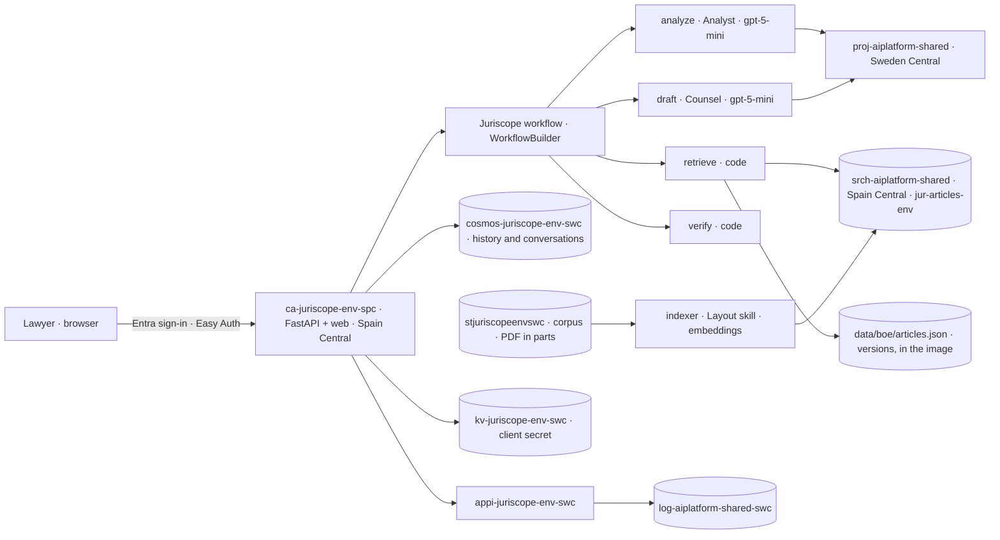

# Architecture

## Regions

- **Spain Central:** the Container Apps environment and app (`cae-` and `ca-juriscope-<env>-spc`), because Sweden Central allows one
  managed environment per subscription and it is taken (author's decision, 2026-11-01). The shared AI Search service is also here.
- **Sweden Central:** everything else of each environment (Cosmos DB, Storage, Key Vault, Application Insights, the runtime
  identity) and the shared Foundry account, registry and workspace.

Search calls stay inside Spain Central. Model, Cosmos DB, Key Vault and telemetry calls cross to Sweden Central: a few KB per
question, which phase 7 measures per step from the deployed app. Nothing is stored at rest in Spain Central except the public text of
the Code in the search index (ADR-009).

## Request path

1. The browser loads the web client from the container app. The client calls `/api/me`; without a session it gets a 401 and goes to
   `/.auth/login/aad`.
2. Easy Auth completes the Entra code flow and sets a session cookie. From then on it injects `X-MS-CLIENT-PRINCIPAL` into every
   request. `app/auth.py` requires the `Juriscope.User` role.
3. `POST /api/conversations/{id}/messages` runs the workflow (ADR-001) and streams `phase` events, then one `answer` or `refusal`,
   over SSE (ADR-004). History and the conversation record are written to Cosmos DB under the user's partition (ADR-002).
4. Telemetry goes to Application Insights with the runtime identity; KPI events carry `user_hash`, never text.

## Deployment path

`ci.yml` and `eval.yml` gate every PR. A merge to `main` builds one image on the runner and deploys it to staging by digest
(`deploy.yml`). After the load test passes, a GitHub Release promotes that digest to production with a 10 % canary
(`release.yml`, ADR-012). The infrastructure is `infra/main.bicep` with one parameter file per environment. Every deployment runs
`what-if` first.

| Module | Resources |
|---|---|
| `infra/main.bicep` | references to the runtime identity, the shared search service and the workspace; the environment's settings |
| `modules/data.bicep` | Cosmos DB (serverless, continuous backup 7 days, two containers with a 90-day TTL, data-plane role), Storage (`corpus`, soft delete), Key Vault (RBAC, the client secret) and their roles |
| `modules/monitor.bicep` | Application Insights (workspace-based, local auth off, daily cap), the workbook, the budget, the action group, two log alerts |
| `modules/app.bicep` | the Container Apps environment and app (multiple revisions, probes, scale rule, Key Vault secret reference), Easy Auth, the 5xx metric alert |
| `modules/roles.bicep` | built-in role names, shared by the modules |
